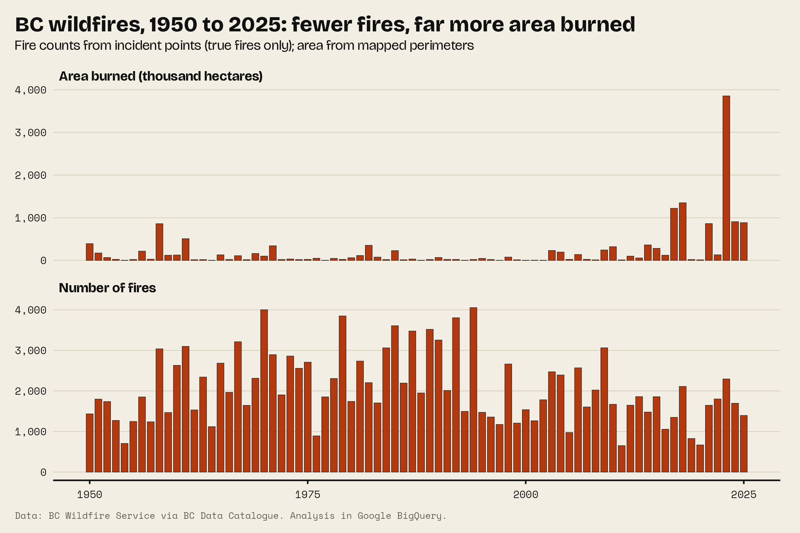
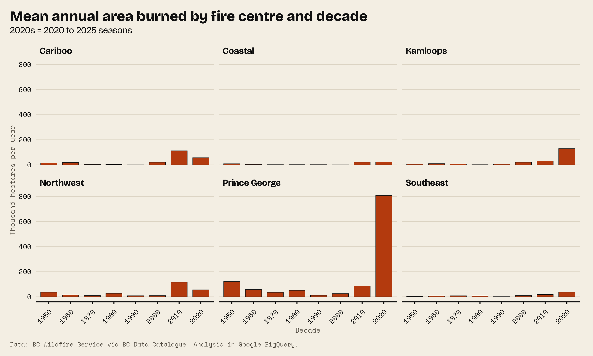

# BC wildfire history in BigQuery

An analysis of 75 years of British Columbia wildfire records (1950 to 2025) using **Google BigQuery** and **BigQuery GIS**, with results pulled into R for visualisation.

The project loads BC Wildfire Service fire incident points and fire perimeter polygons into BigQuery, builds GEOGRAPHY columns, and uses SQL to summarise fire counts and area burned by year, fire centre, and cause. It also runs a spatial query measuring area burned near five BC communities.



## Key findings

- **Area burned has risen sharply while the number of fires has not.**
  - From 2020 to 2025, mean annual area burned was about **1.11 million ha**.
  - That compares with about 386,000 ha in the 2010s and 31,000 ha in the 1990s.
  - Annual counts of fires since 2020 (670 to 2,296) are within or below the historical range. The peak years, with 3,500 to 4,000 fires, were all between 1970 and 1994.
- **2023 was an extreme outlier.**
  - About **3.86 million ha** burned.
  - That is nearly three times the next largest seasons, 2018 (1.35 million ha) and 2017 (1.22 million ha).
- **Very large fires are far more common.**
  - There were 89 fires of 10,000 ha or more in the six seasons from 2020 to 2025.
  - The whole of the 1990s had 6.
- **Lightning drives most of the area burned.**
  - Lightning caused 48% of fires but **77% of area burned**.
  - Human-caused fires are almost as frequent (45%) but account for 23% of area burned.
- **Area burned is concentrated in the north.**
  - Prince George Fire Centre accounts for **54%** of area burned since 1950.
  - Kamloops has the most fires (about 42,000) but under 10% of area burned.
- **Area burned near communities has increased.**
  - Within 50 km of Kamloops, about 109,000 ha burned in 2020 to 2025, compared with no more than about 30,000 ha in any earlier decade.
  - Williams Lake saw about 140,000 ha within 50 km in the 2010s, mostly from the 2017 fires.



## Data

| Dataset | Description | Records |
|---|---|---|
| [BC Wildfire Fire Incident Locations - Historical](https://catalogue.data.gov.bc.ca/dataset/bc-wildfire-fire-incident-locations-historical) | Point locations of all incidents tracked by BC Wildfire Service | 200,479 |
| [BC Wildfire Fire Perimeters - Historical](https://catalogue.data.gov.bc.ca/dataset/bc-wildfire-fire-perimeters-historical) | Mapped fire perimeter polygons | 24,751 |

- **Publisher:** Government of British Columbia, BC Wildfire Service, via the BC Data Catalogue
- **Licence:** Open Government Licence - British Columbia
- **Accessed:** 16 November 2026
- Neither dataset is intended for legal purposes. Raw data are not stored in this repository; `R/01_download_data.R` re-downloads them.

## Methods

1. **Extraction (R):**
   - Downloaded both layers with the [`bcdata`](https://github.com/bcgov/bcdata) package.
   - Requests for the full layers failed at scale, so extraction was chunked by fire year, with retries.
   - Column types that differed between years (for example `VERSION_NUMBER`) were harmonised before combining.
   - Perimeters were repaired with `st_make_valid()`, simplified to a 50 m tolerance, transformed to WGS84, and exported with geometry as WKT text.
2. **Loading (BigQuery):**
   - Uploaded both files as CSV to a BigQuery sandbox dataset.
   - The incidents table was loaded with an explicit schema, because auto detect rejected rows with invalid dates.
3. **Table building (`sql/01_create_tables.sql`):**
   - Built point geographies with `ST_GEOGPOINT`.
   - Built polygon geographies with `ST_GEOGFROMTEXT(..., make_valid => TRUE)`.
   - Parsed dates with `SAFE.PARSE_DATE`.
4. **Data quality checks:**
   - All 200,479 incidents and 24,751 perimeters produced valid geometries.
   - Areas calculated with `ST_AREA` were within about 0.5% of the recorded fire sizes for the largest fires. This is consistent with the shape simplification.
   - Five ignition dates had impossible years (for example 223 and 1499) and were set to missing. Annual summaries use `FIRE_YEAR`, so they are unaffected.
   - Fire centre was derived from the fire number prefix. It matched the `FIRE_CENTRE` code one-to-one for all 156,624 fires.
5. **Analysis (`sql/02_analysis.sql`):**
   - Fire counts use incident points restricted to `FIRE_TYPE = 'Fire'`, which excludes nuisance fires, smoke chases, duplicates, and other non-fire incidents.
   - Area burned uses perimeter `FIRE_SIZE_HECTARES`.
   - The spatial query uses `ST_DWITHIN`, `ST_BUFFER`, and `ST_INTERSECTION` to measure area burned within 50 km of five communities.
6. **Visualisation (`R/02_figures.R`):**
   - Queried BigQuery directly from R with [`bigrquery`](https://bigrquery.r-dbi.org/) and plotted with ggplot2.

## Limitations

- **Perimeter mapping has changed over time.**
  - Before about 2006, few small fires were mapped. For example, 2001 and 2002 have only 10 to 15 perimeters each.
  - Fire counts therefore come from incident points.
  - Area totals are dominated by large fires, which were mapped throughout, but early totals may be slightly underestimated.
- **Holdover fires:**
  - Some fires overwinter and are recorded again in the following season under a new number. For example, the 2024 Nogah Creek fire has a 2023 ignition date.
  - Some area may be counted in more than one season.
- **Reburns:** area that burned more than once is counted each time, including in the 50 km community totals.
- **Incomplete decade:** the 2020s figures cover six seasons (2020 to 2025), and the decade averages account for this.
- **Simplified geometry:** perimeters were simplified to 50 m, which is suitable for provincial summaries but not for parcel-level work.
- **Descriptive only:** no adjustment is made for changes in detection, suppression policy, reporting, or climate.

## Repository structure

```
bc-wildfire-bigquery/
├── R/
│   ├── 01_download_data.R     # extract from BC Data Catalogue, write CSVs
│   └── 02_figures.R           # query BigQuery from R, make figures
├── sql/
│   ├── 01_create_tables.sql   # build tables, GEOGRAPHY columns, quality checks
│   └── 02_analysis.sql        # summaries by year, fire centre, cause; GIS query
├── figures/
└── README.md
```

## How to reproduce

1. Create a Google Cloud project with the BigQuery sandbox (no billing needed) and a dataset called `bc_wildfire`.
2. Run `R/01_download_data.R` to create `data/fire_incidents.csv` and `data/fire_perimeters.csv`.
3. Upload the CSVs to BigQuery as `fire_incidents_raw` and `fire_perimeters_raw`.
   - For the incidents, use this schema and skip 1 header row:
     ```
     FIRE_NUMBER:STRING,FIRE_YEAR:INTEGER,FIRE_TYPE:STRING,FIRE_CAUSE:STRING,FIRE_CENTRE:STRING,ZONE:STRING,RESPONSE_TYPE_DESC:STRING,IGNITION_DATE:STRING,FIRE_OUT_DATE:STRING,CURRENT_SIZE:FLOAT,LATITUDE:FLOAT,LONGITUDE:FLOAT,INCIDENT_NAME:STRING
     ```
4. Run `sql/01_create_tables.sql`, then `sql/02_analysis.sql`, in the BigQuery console. Replace the project ID if yours differs.
5. Run `R/02_figures.R`.

Note: BigQuery sandbox tables expire after 60 days, so this repository holds the full pipeline rather than relying on the cloud tables persisting.

## Tools

Google BigQuery (sandbox), BigQuery GIS, SQL, R (bcdata, sf, dplyr, bigrquery, ggplot2), Git and GitHub.

## Author

Emma Branch, epidemiologist and PhD candidate, University of British Columbia. [github.com/emmabranch](https://github.com/emmabranch)
